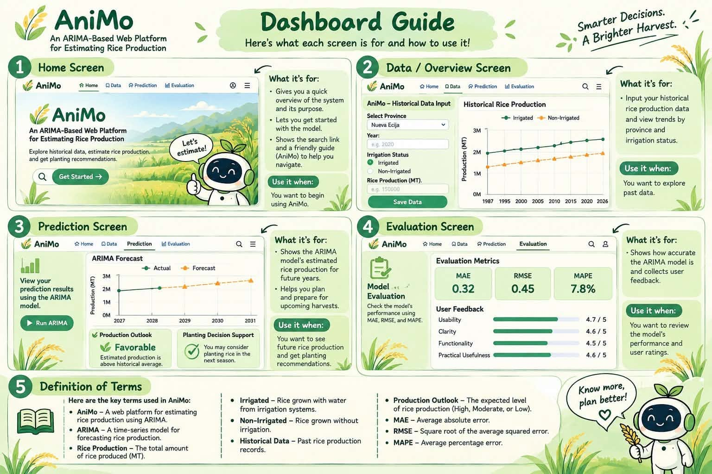
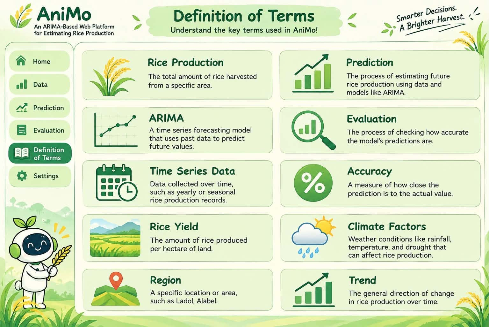

# AniMo

**An ARIMA-Based Web Platform for Estimating Rice Production.**

AniMo lets users record historical rice production, view trends, forecast production for future years with an ARIMA time-series model, and get a simple production outlook and planting recommendation.

Tagline: _Smarter Decisions. A Brighter Harvest._

## Screens

### 1. Home

- Quick overview of the system and its purpose
- "Get Started" button and a search link
- AniMo mascot as a friendly guide ("Let's estimate!")

### 2. Data / Overview

- **Historical Data Input** form: Location (province), Year, Irrigation Status (Irrigated / Non-Irrigated), Rice Production (MT), then **Save Data**
- **Historical Rice Production** line chart: production (MT) per year, one line for Irrigated and one for Non-Irrigated

### 3. Prediction

- **Run ARIMA** button for the selected location and irrigation status
- **ARIMA Forecast** chart: actual values vs. forecast for the next years (e.g. 5 years ahead)
- **Production Outlook** card: High / Moderate / Low (shown as e.g. "Favorable — estimated production is above historical average")
- **Planting Decision Support** card: a short recommendation (e.g. "You may consider planting rice in the next season")

### 4. Evaluation

- **Evaluation Metrics**: MAE, RMSE, MAPE of the ARIMA model
- **User Feedback**: average ratings (out of 5) for Usability, Clarity, Functionality and Practical Usefulness, plus a form for users to submit their own rating

### 5. Definition of Terms

Glossary page with an icon card per term:

| Term               | Definition                                                                    |
| ------------------ | ----------------------------------------------------------------------------- |
| AniMo              | A web platform for estimating rice production using ARIMA.                    |
| ARIMA              | A time series forecasting model that uses past data to predict future values. |
| Rice Production    | The total amount of rice produced/harvested from a specific area (MT).        |
| Rice Yield         | The amount of rice produced per hectare of land.                              |
| Time Series Data   | Data collected over time, such as yearly or seasonal rice production records. |
| Historical Data    | Past rice production records.                                                 |
| Irrigated          | Rice grown with water from irrigation systems.                                |
| Non-Irrigated      | Rice grown without irrigation.                                                |
| Region             | A specific location or area, such as Ladol, Alabel.                           |
| Prediction         | The process of estimating future rice production using data and models like ARIMA. |
| Production Outlook | The expected level of rice production (High, Moderate, or Low).              |
| Evaluation         | The process of checking how accurate the model's predictions are.            |
| Accuracy           | A measure of how close the prediction is to the actual value.                 |
| Trend              | The general direction of change in rice production over time.                 |
| Climate Factors    | Weather conditions like rainfall, temperature and drought that can affect rice production. |
| MAE                | Average absolute error.                                                       |
| RMSE               | Square root of the average squared error.                                     |
| MAPE               | Average percentage error.                                                     |

### 6. Settings

- Account settings, and user / role management for admins

## Navigation

Top bar (Home, Data, Prediction, Evaluation, search, user menu) on wide screens; sidebar style (Home, Data, Prediction, Evaluation, Definition of Terms, Settings) as shown in the glossary mockup.

## Look and Feel

- Soft green, rice-field theme with the AniMo robot mascot holding a rice stalk
- Simple, friendly dashboard so non-technical users can use it

## Mockups

AI-generated mockups to help imagine the overall look of the system:

> **Note:** The mockups are only a visual guide, not the actual final website.
